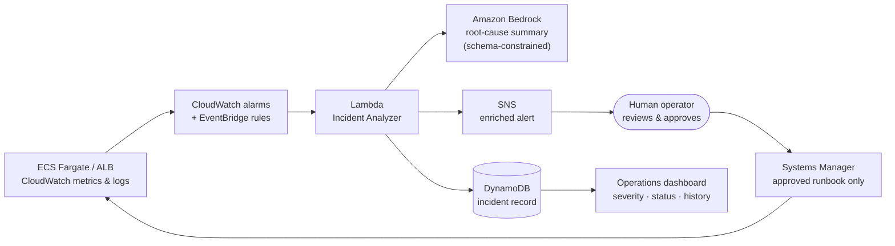

# AWS AIOps Cloud Operations Platform

**Detect infrastructure problems, investigate incidents automatically, explain probable causes with
AI, and remediate safely, with a human approving every change.**

`AWS` · `Terraform` · `Python 3.13` · `CloudWatch` · `EventBridge` · `Lambda` · `Amazon Bedrock (Claude)` ·
`Systems Manager Automation` · `ECS Fargate` · `DynamoDB` · `GitHub Actions (OIDC)`

[](https://github.com/oteyami2001/AWS-Cloud-Operations-AI-Automation/actions/workflows/ci.yml)

> **Project status: be precise about this.**
> | Layer | Status |
> |---|---|
> | Code, Terraform, tests, CI workflows, docs | ✅ Complete, and verified **locally**: 60 Python tests at ≈93% coverage, 25 offline `terraform test` assertions, tflint, Checkov (0 failed) and Trivy (0 HIGH/CRITICAL). See [`docs/security-review.md`](docs/security-review.md) |
> | Offline end-to-end incident simulation | ✅ [`docs/evidence/local/incident-simulation.md`](docs/evidence/local/incident-simulation.md) (mocked AWS) |
> | AWS deployment, screenshots, Bedrock calls, ALB load test, video | ⏸️ **Not yet deployed.** The deployment plan is ready ([`docs/deployment-plan.md`](docs/deployment-plan.md)) and waits for the owner's approval (billable). Checklist: [`docs/evidence/README.md`](docs/evidence/README.md) |

---

## The problem

Large organisations run thousands of cloud resources. Engineers spend hours on the same triage
loop: an alarm fires, someone opens five consoles to gather context, guesses a cause, and applies a
fix by hand. That fix is often unreviewed and can be risky.

## The solution



1. **Detect:** CloudWatch alarms for CPU, memory, HTTP 5xx, application error logs, unhealthy targets, and
   no healthy targets. ECS task-stop events are also captured.
2. **Route:** EventBridge sends alarm state changes, task stops and SSM execution status to Lambda. It retries failed deliveries and then moves them to a DLQ.
3. **Investigate:** the analyzer deduplicates and correlates signals. It collects redacted evidence (ECS
   service state, stopped-task exit codes, target health, recent error logs, metrics) and sets
   severity using fixed rules (no AI involved).
4. **Explain:** Claude on Amazon Bedrock summarises the evidence and recommends troubleshooting steps
   and **one runbook id from an approved list**. If Bedrock is off, over quota, failing, or refuses, a deterministic rules
   engine produces the analysis instead.
5. **Approve:** an operator reviews the evidence and approves or rejects through an IAM-authenticated
   endpoint. HIGH-risk runbooks also wait for a **second approver** inside SSM (`aws:approve`).
6. **Remediate and document:** SSM Automation runs the bounded runbook. The incident record captures
   who approved what, the outcome, and the time to recover.

Detailed diagrams (component, sequence, state machine, trust boundaries):
[`docs/architecture.md`](docs/architecture.md). Decisions: [`docs/adr/0001-architecture.md`](docs/adr/0001-architecture.md).

## Engineering safeguard: AI recommends, humans decide

| Guarantee | How it is enforced | Proof |
|---|---|---|
| AI cannot change infrastructure | Analyzer IAM role has **no** SSM, ECS write, or PassRole permissions | `terraform test`: `analyzer_cannot_change_infrastructure` |
| AI can only suggest approved actions | Structured output with an **enum** of runbook ids for the incident category, re-validated in code | `tests/unit/test_ai.py` (incl. a prompt-injection test) |
| No change without a named human | IAM-authenticated Function URL; the approver comes from the verified caller ARN; justification is required | `tests/unit/test_remediation.py` |
| Two-person rule for HIGH risk | `aws:approve` first step plus a separate senior-approver role | SSM document test + `access.tf` |
| Bounded blast radius | 4 allowlisted SSM documents, parameters from trusted incident data, `allowedValues` caps, role scoped to one ECS service | `test_catalog_parameters_come_from_trusted_resource` |
| No billable deploy without approval | `deploy.yml` is manual, and apply runs only in a reviewer-protected GitHub environment | `.github/workflows/deploy.yml` |

## Quick start (local, no AWS account needed)

```bash
python3 -m venv .venv && . .venv/bin/activate && make install
```

```bash
make lint test
```

```bash
make tf-validate tf-test tflint checkov trivy
```

```bash
make demo-local
```

`make demo-local` runs the real platform code end to end against mocked AWS for three scenarios:
stopped app → approved restore, unhealthy task → self-healed and auto-resolved, 5xx spike → HIGH-risk
rollback waiting for a second approval.

## Deploy to AWS (billable, ≈ $1.35/day while running)

See [`docs/deployment-plan.md`](docs/deployment-plan.md): the bootstrap (state, OIDC roles, ECR, budget), image publish, plan, the approval-gated apply,
operator profiles, and how to enable Bedrock. Then follow the demo script in
[`docs/demo-scenario.md`](docs/demo-scenario.md) and clean up with [`docs/cleanup.md`](docs/cleanup.md).

```bash
scripts/simulate_incident.sh stop
```

```bash
AWS_PROFILE=aiops-operator python scripts/approve.py --incident <INC-id> --show
```

```bash
AWS_PROFILE=aiops-operator python scripts/approve.py --incident <INC-id> --decision approve --justification "Service scaled to 0 by mistake; restoring baseline."
```

## Repository layout

| Path | Contents |
|---|---|
| `src/aiops/` | Lambda package: events, evidence, severity, rules, Bedrock analysis, runbook catalog, store, 4 handlers |
| `src/sample_app/` | Monitored workload with token-protected fault injection, non-root Dockerfile |
| `terraform/modules/` | `security` · `network` · `workload` · `monitoring` · `aiops` · `remediation` (SSM docs) · `dashboard` |
| `terraform/envs/dev/` | Composition root, tfvars example, offline plan tests |
| `terraform/bootstrap/` | S3 state bucket (S3-native locking), GitHub OIDC plan / apply / image-push roles, workload permissions boundary, ECR repository, account budget |
| `tests/` | pytest + moto tests and EventBridge event fixtures |
| `scripts/` | build, approve (SigV4), simulate incidents, load test, offline demo |
| `.github/workflows/` | `ci.yml` (no AWS access), `image.yml` (build, scan, push) and `deploy.yml` (manual, OIDC, approval-gated). All actions are pinned to commit SHAs |
| `docs/` | ADR, architecture, cost, security, implementation plan, runbooks, evidence, talking points |

## CI/CD

| Workflow | Trigger | Jobs |
|---|---|---|
| `ci` | push / PR | ruff, bandit, pytest + 85% coverage gate, offline incident simulation · terraform fmt/validate/test, tflint · checkov (SARIF to code scanning) · Docker build, read-only smoke test, Trivy |
| `image` | manual, `main` | build → Trivy gate → push an immutable tag (image-push role) |
| `deploy` | manual, `main` | `plan` with the read-only OIDC role → `apply`/`destroy` of that saved plan only after a required reviewer approves the `aws-dev` environment |

## Security, cost, operations

- **Security:** least-privilege per-function IAM, a customer-managed KMS key for all data stores,
  logs, queues and topics, Secrets Manager, MFA-protected human roles, OIDC (no stored keys),
  checkov/tflint/bandit/Trivy. Pre-deployment review, including every accepted risk: [`docs/security-review.md`](docs/security-review.md).
- **Cost:** ≈ $38–43/month if left running, or ≈ $0.20–0.35 per demo session under 3 hours. Includes an AWS Budget, cost-allocation
  tags, a Bedrock daily call cap, reserved concurrency, and no NAT gateway. See [`docs/cost-estimate.md`](docs/cost-estimate.md).
- **Operations:** [`docs/runbooks/operator-runbook.md`](docs/runbooks/operator-runbook.md), platform
  self-monitoring alarms (analyzer errors, DLQ), EMF metrics (incidents opened/resolved, time to recover), X-Ray.
- **Plan and roadmap:** [`docs/implementation-plan.md`](docs/implementation-plan.md) separates what is
  done locally, what awaits deployment, and what is planned (HTTPS/WAF, drift and cost-anomaly
  incidents, Slack approvals, multi-account).
- **Interview prep:** [`docs/interview-talking-points.md`](docs/interview-talking-points.md).

## Evidence

| Kind | Where | Status |
|---|---|---|
| Test reports, coverage, Terraform validation and tests, checkov, local simulation, local load test | `docs/evidence/local/` | ✅ |
| Workflow runs | GitHub Actions tab | ⏳ after push |
| AWS screenshots, Bedrock output, ALB load test, cleanup proof, video | `docs/evidence/aws/` | ⏸️ after approved deployment |
