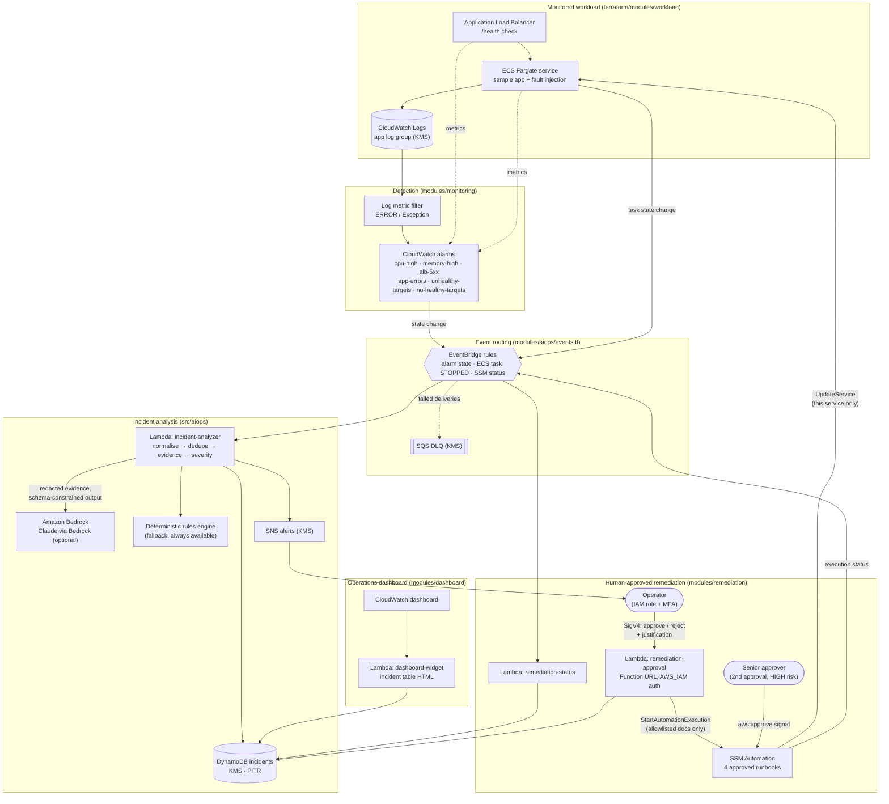
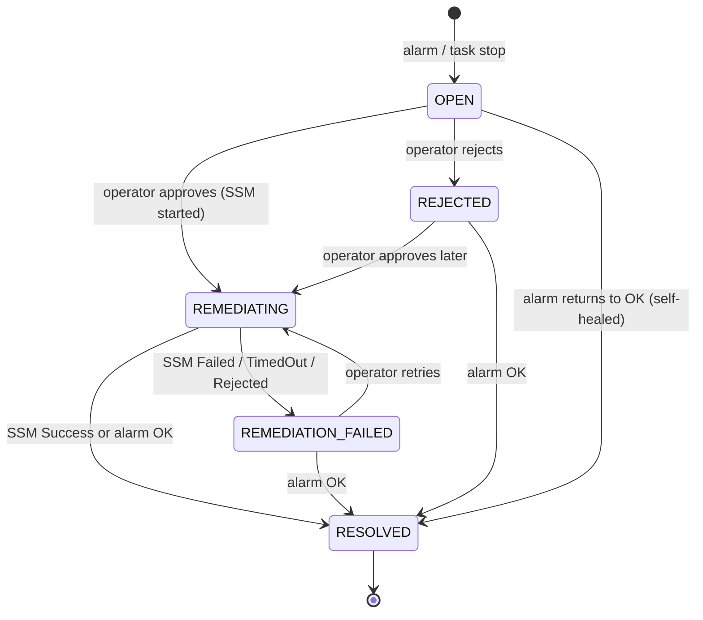

# Architecture

## Component view



## Incident lifecycle (sequence)

```mermaid
sequenceDiagram
    autonumber
    participant CW as CloudWatch alarm
    participant EB as EventBridge
    participant AN as Analyzer Lambda
    participant BR as Bedrock (optional)
    participant DB as DynamoDB
    participant H as Operator (human)
    participant AP as Approval Lambda
    participant SSM as SSM Automation
    participant ST as Status Lambda

    CW->>EB: OK → ALARM
    EB->>AN: CloudWatch Alarm State Change
    AN->>DB: open incident for dedupe key?
    alt already open
        AN->>DB: append SIGNAL_REPEATED (no new analysis, no new Bedrock call)
    else new incident
        AN->>AN: collect evidence (ECS, target health, logs, metrics) + redact secrets
        AN->>AN: severity (deterministic)
        AN->>BR: evidence (untrusted block) + approved runbook ids
        BR-->>AN: JSON {summary, cause, steps, recommended_runbook ∈ enum}
        AN->>AN: validate; on any failure → rules engine
        AN->>DB: incident OPEN + history
        AN-->>H: SNS: summary, cause, recommendation, approve command
    end
    H->>AP: SigV4 POST {decision, justification}
    AP->>AP: verify IAM caller ARN, status, catalog, category
    AP->>SSM: StartAutomationExecution(approved doc, params from incident)
    AP->>DB: REMEDIATING + approver identity
    opt HIGH risk runbook
        SSM-->>H: waits at aws:approve for senior-approver role
    end
    SSM->>EB: execution status Success / Failed
    EB->>ST: status event
    ST->>DB: RESOLVED / REMEDIATION_FAILED
    CW->>EB: ALARM → OK
    EB->>AN: state change
    AN->>DB: RESOLVED (records time-to-recover metric)
```

## Incident state machine



## Trust boundaries

| Boundary | Control |
|---|---|
| Log lines / evidence → model | Treated as untrusted data in a delimited block; secrets redacted first; output is a JSON schema with an **enum** of approved runbook ids; re-validated in code. |
| Model output → infrastructure | No path exists. The analyzer role has no SSM/ECS write permissions (asserted by `terraform test`). |
| Human → remediation | IAM-authenticated Function URL; approver identity is the verified caller ARN, not the request body; justification required. |
| Remediation → AWS | Only 4 allowlisted SSM documents; parameters built from the incident's resource ids; SSM role limited to one ECS service; desired counts bounded by `allowedValues`. |
| HIGH risk | `aws:approve` step inside the SSM document → a second principal (senior-approver role) must approve. |

## Repository structure

```
.
├── src/
│   ├── aiops/                  # Lambda code (one package, four handlers)
│   │   ├── events.py           # EventBridge → Signal normalisation
│   │   ├── evidence.py         # read-only evidence collectors + secret redaction
│   │   ├── severity.py         # deterministic severity
│   │   ├── rules.py            # deterministic root-cause playbook (fallback)
│   │   ├── ai.py               # Bedrock analysis, schema-constrained, validated
│   │   ├── runbooks.py         # APPROVED runbook catalog (allowlist)
│   │   ├── store.py            # DynamoDB repository + Bedrock daily quota
│   │   └── handlers/           # analyzer · remediation · status · dashboard
│   └── sample_app/             # monitored workload with fault injection + Dockerfile
├── terraform/
│   ├── bootstrap/              # state bucket, lock table, GitHub OIDC roles
│   ├── envs/dev/               # composition root (+ offline terraform tests)
│   └── modules/                # security · network · workload · monitoring · aiops · remediation · dashboard
├── tests/                      # pytest unit + integration (moto) tests, event fixtures
├── scripts/                    # build, approve, simulate, load test, offline demo
├── docs/                       # ADR, architecture, cost, security, runbooks, evidence
└── .github/workflows/          # ci.yml (no AWS), deploy.yml (manual, approval-gated)
```
