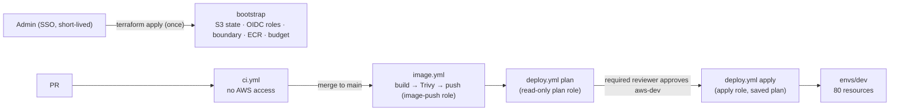

# Deployment guide

The authoritative, step-by-step plan, including the resource inventory, cost, exact commands, the
validation steps and cleanup, is **[`deployment-plan.md`](deployment-plan.md)**.

## Architecture of the delivery pipeline



| Workflow | Trigger | AWS role | What it can do |
|---|---|---|---|
| `ci.yml` | every push / PR | none | lint, SAST, tests, Terraform validate/test, tflint, Checkov, Docker build + Trivy |
| `image.yml` | manual, `main` only | `aiops-github-image-push` | push one immutable tag to one ECR repository |
| `deploy.yml` plan | manual, `main` only | `aiops-github-plan` | read-only describe + state lock |
| `deploy.yml` apply/destroy | after `aws-dev` approval | `aiops-github-apply` | create/update/destroy `envs/dev` in `us-east-1` within the permissions boundary |

## Local development (no AWS)

```bash
python3 -m venv .venv && . .venv/bin/activate && make install
```

```bash
make lint test tf-fmt tf-validate tf-test tflint checkov trivy demo-local
```

## Operator access after deployment

Create a CLI profile that assumes the operator role with MFA (`~/.aws/config`):

```ini
[profile aiops-operator]
role_arn = <terraform output operator_role_arn>
source_profile = aiops-admin
mfa_serial = arn:aws:iam::<account-id>:mfa/<your-device>
```

```bash
AWS_PROFILE=aiops-operator python scripts/approve.py --incident <INC-id> --show
```

Create a matching `aiops-senior-approver` profile for second approvals of HIGH-risk runbooks.

## Enabling Bedrock later (Phase 4)

1. Enable model access in the Bedrock console.
2. Set `bedrock_enabled = true`.
3. Confirm that the IAM actions the Bedrock endpoint requires are present in **both** `bedrock_iam_actions` and the workload permissions boundary (`terraform/bootstrap/boundary.tf`).
4. Plan and apply through `deploy.yml`.
